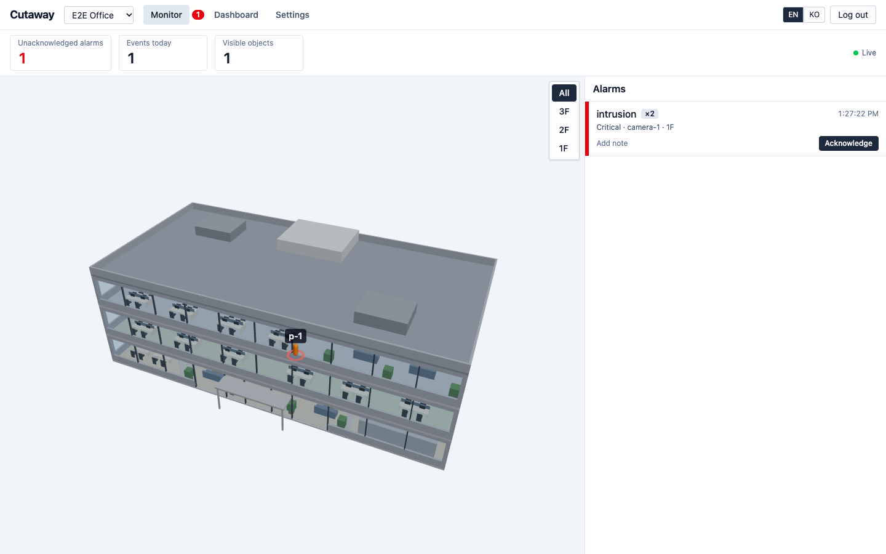

# dt

[English](README.md) | **한국어**

**3D 실내 모니터링**을 위한 오픈소스 웹 앱이다. 건물의 glTF 모델을 올리고 층마다 카메라와 센서를 배치하면, 알람과 움직이는 객체(사람, 차량, 사물)를 실시간으로 볼 수 있다. 외부 시스템은 간단한 HTTP API로 데이터를 보낸다.



## 기능

- 현장 여러 개, 현장마다 3D 모델(`.glb`) 하나, 높이 구간으로 정하는 층(업로드할 때 자동 제안)
- 모델 위에 카메라(화각 표시)와 일반 센서 배치
- 수신 창구 두 개: **이벤트**(알람 생성, 대시보드 통계 반영)와 **위치**(객체 마커만 이동)
- 알람 폭주를 막는 알람 묶기, 확인 처리, 모든 현장의 미확인 알람 배지
- WebSocket 실시간 3D 화면. 정보가 끊긴 객체는 서서히 사라진다
- 대시보드: 이벤트 추이, 유형·심각도·장치·층별 통계
- 폐쇄망에서 동작: 런타임에 CDN, 웹폰트, 원격 디코더를 쓰지 않는다
- 화면 언어는 영어와 한국어

## 빠른 시작

Docker와 Compose가 필요하다.

```bash
cp .env.example .env
# .env 수정: ADMIN_PASSWORD(8자 이상), SESSION_SECRET(32자 이상 무작위 값)
openssl rand -base64 48   # SESSION_SECRET으로 쓸 값을 출력한다
docker compose up -d
```

두 값 중 하나라도 비어 있거나 예시 값이면 서버가 시작하지 않는다.

<http://localhost:8080>을 열고 `ADMIN_USERNAME`(기본 `admin`)과 `ADMIN_PASSWORD`로 로그인한다.

모델 파일은 기본으로 로컬 볼륨에 저장한다. S3 호환 저장소를 쓰려면 `STORAGE_DRIVER=s3`와 `S3_*` 변수를 설정한다. 로컬 시험용 MinIO 프로필이 있다(버킷 `dt-data`).

```bash
docker compose --profile s3 up -d
```

MinIO 이미지(`bitnamilegacy/minio`)는 **로컬 시험용**이다. 운영에서는 `S3_*`를 관리되는 S3 호환 서비스에 연결한다. 자세한 내용은 [docs/deploy.md](docs/deploy.md)를 본다.

## 샘플로 체험하기

서버가 떠 있는 상태(compose 또는 아래 `pnpm dev`)에서, 3층 사무실 모델과 장치, 연동 키가 있는 샘플 현장을 만들고 시뮬레이션 데이터를 보낸다. 시뮬레이터는 호스트에서 돌기 때문에 이 단계에는 Docker 말고도 Node.js 22 이상과 corepack으로 쓰는 pnpm이 필요하다.

```bash
corepack enable                                      # 한 번만. pnpm을 쓸 수 있게 한다
pnpm install
ADMIN_PASSWORD=<관리자 비밀번호> pnpm sim seed      # .sim.json을 만들고 모니터링 주소를 출력한다
pnpm sim run                                         # 움직이는 사람, 침입·센서 이벤트
```

주요 플래그(`tools/simulator/src/cli.ts` 참고):

| 명령            | 플래그                                                                                 |
| --------------- | -------------------------------------------------------------------------------------- |
| `pnpm sim seed` | `--url`(기본 `http://localhost:8080`), `--site-name`(기본 "Sample Office")             |
| `pnpm sim run`  | `--url`, `--people`(기본 6), `--seconds`(생략하면 Ctrl+C까지)                          |
| `pnpm sim load` | `--url`, `--seconds`(기본 30). 위치 500건/초 + 이벤트 20건/초를 보내고 지연을 출력한다 |

## 외부 시스템 연동

설정 > 연동 키에서 키를 발급하고 HTTP `POST`로 보낸다.

```bash
curl -X POST http://localhost:8080/api/ingest/positions \
  -H "Authorization: Bearer dtk_..." -H "Content-Type: application/json" \
  -d '{"deviceId":"cam-1","x":12.5,"y":4.2,"measuredAt":"2026-11-04T09:30:00+09:00","objectId":"tag-1","objectType":"person"}'

curl -X POST http://localhost:8080/api/ingest/events \
  -H "Authorization: Bearer dtk_..." -H "Content-Type: application/json" \
  -d '{"deviceId":"cam-1","eventType":"intrusion","occurredAt":"2026-11-04T09:30:01+09:00","severity":"major"}'
```

| 경로                         | 용도                                                    |
| ---------------------------- | ------------------------------------------------------- |
| `POST /api/ingest/events`    | 알람을 만들고 통계에 들어간다                           |
| `POST /api/ingest/positions` | 객체 마커만 움직인다(메시지 하나 또는 최대 1000건 배열) |

좌표는 m 단위이며 `x` = 모델 X, `y` = -모델 Z다(glTF는 Y-up). 시각에는 시간대를 넣어야 한다. 추적 중인 객체는 최소 1초에 한 번 보낸다. 필드, 한도, 오류 코드, 좌표계 전체는 [docs/integration.md](docs/integration.md)에 있다. 대화형 API 문서는 `/api/docs`에서 볼 수 있다.

## 문서

- [docs/integration.md](docs/integration.md): 외부 시스템 연동 규격
- [docs/model-spec.md](docs/model-spec.md): 3D 모델 규격(GLB, m, Y-up, 층)
- [docs/deploy.md](docs/deploy.md): 환경변수, 온프레미스·클라우드 배포, 백업, 제한

## 개발

Node.js 22 이상(CI와 Docker 이미지는 24)과 corepack으로 쓰는 pnpm 12가 필요하다.

```bash
corepack enable
pnpm install
cp .env.example .env     # DB_DRIVER=pglite와 로컬 저장소는 Docker 없이 동작한다
# .env에 ADMIN_PASSWORD와 SESSION_SECRET을 정한다 (openssl rand -base64 48)
pnpm dev                 # API는 :8080, 화면(Vite)은 /api 프록시 포함
pnpm test                # 단위·통합 테스트
pnpm e2e                 # Playwright E2E (포트 변경: E2E_PORT=18081)
pnpm lint && pnpm -r typecheck && pnpm build
```

E2E를 처음 돌리기 전에 `pnpm exec playwright install chromium`을 실행한다.

레포 구조:

| 경로                 | 내용                                  |
| -------------------- | ------------------------------------- |
| `apps/web`           | React + Vite + react-three-fiber 화면 |
| `apps/server`        | Fastify API 서버                      |
| `packages/shared`    | zod 스키마와 공유 타입                |
| `tools/simulator`    | 시드와 트래픽 시뮬레이터 CLI          |
| `tools/sample-model` | `samples/office-3f.glb` 생성기        |
| `e2e`                | Playwright 테스트                     |

## 제한 (v1)

서버 인스턴스 하나, 객체 위치는 메모리에만 보관(이력 재생 없음), 관리자 계정 하나.

## 라이선스

[MIT](LICENSE) (c) 2026 GagaKor
