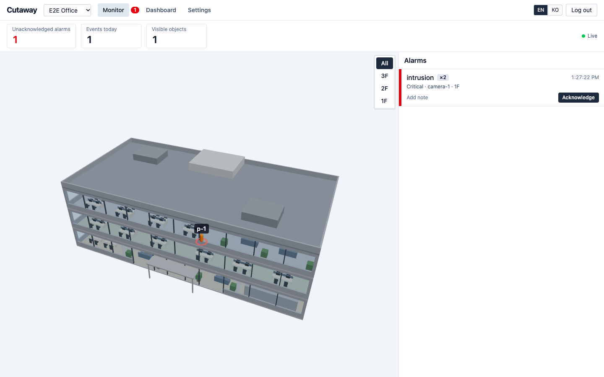

# dt

**English** | [한국어](README.ko.md)

An open-source web app for **3D indoor monitoring**. Upload a glTF model of a building, place cameras and sensors on its floors, and watch alarms and moving objects (people, vehicles, things) in real time. External systems feed it over a small HTTP API.



## Features

- Multiple sites, one 3D model (`.glb`) per site, floors defined by height ranges (auto-suggested on upload)
- Camera (with field of view) and generic sensor devices placed on the model
- Two ingest endpoints: **events** (create alarms, feed dashboard statistics) and **positions** (move object markers only)
- Alarm grouping to prevent alarm storms, acknowledge flow, cross-site unacknowledged badge
- Live 3D view over WebSocket; objects fade out when updates stop
- Dashboard: event trends, by type / severity / device / floor
- Works offline: no CDN, web fonts or remote decoders at runtime
- English and Korean UI

## Quick start

Requires Docker with Compose.

```bash
cp .env.example .env
# edit .env: set ADMIN_PASSWORD (8+ chars) and SESSION_SECRET (32+ random chars)
openssl rand -base64 48   # prints a value you can use as SESSION_SECRET
docker compose up -d
```

The server refuses to start while either value is empty or still an example value.

Open <http://localhost:8080> and log in with `ADMIN_USERNAME` (default `admin`) and your `ADMIN_PASSWORD`.

Model files are stored on a local volume by default. To use an S3-compatible store, set `STORAGE_DRIVER=s3` and the `S3_*` variables. For local testing there is a MinIO profile (bucket `dt-data`):

```bash
docker compose --profile s3 up -d
```

The MinIO image (`bitnamilegacy/minio`) is for local testing only. In production, point `S3_*` at a maintained S3-compatible service. See [docs/deploy.md](docs/deploy.md) (Korean).

## Try it with sample data

With the server running (compose, or `pnpm dev` below), create a sample site with a 3-floor office model, devices and an integration key, then send simulated traffic. The simulator runs on the host, so besides Docker this step needs Node.js 22 or later and pnpm via corepack:

```bash
corepack enable                                          # once; provides pnpm
pnpm install
ADMIN_PASSWORD=<your admin password> pnpm sim seed      # writes .sim.json, prints the monitor URL
pnpm sim run                                             # moving people, intrusion and sensor events
```

Useful flags (see `tools/simulator/src/cli.ts`):

| Command         | Flags                                                                                     |
| --------------- | ----------------------------------------------------------------------------------------- |
| `pnpm sim seed` | `--url` (default `http://localhost:8080`), `--site-name` (default "Sample Office")        |
| `pnpm sim run`  | `--url`, `--people` (default 6), `--seconds` (default: until Ctrl+C)                      |
| `pnpm sim load` | `--url`, `--seconds` (default 30); sends 500 positions/s + 20 events/s and prints latency |

## Connecting an external system

Send HTTP `POST` requests with an integration key (create one under Settings > Keys):

```bash
curl -X POST http://localhost:8080/api/ingest/positions \
  -H "Authorization: Bearer dtk_..." -H "Content-Type: application/json" \
  -d '{"deviceId":"cam-1","x":12.5,"y":4.2,"measuredAt":"2026-11-04T09:30:00+09:00","objectId":"tag-1","objectType":"person"}'

curl -X POST http://localhost:8080/api/ingest/events \
  -H "Authorization: Bearer dtk_..." -H "Content-Type: application/json" \
  -d '{"deviceId":"cam-1","eventType":"intrusion","occurredAt":"2026-11-04T09:30:01+09:00","severity":"major"}'
```

| Endpoint                     | Purpose                                                              |
| ---------------------------- | -------------------------------------------------------------------- |
| `POST /api/ingest/events`    | Creates alarms, counts in statistics                                 |
| `POST /api/ingest/positions` | Moves object markers only (single message or an array of up to 1000) |

Coordinates are in meters: `x` = model X, `y` = -model Z (glTF is Y-up). Timestamps must include a time zone. Send tracked objects at least once per second. The full contract (fields, limits, error codes, coordinate system) is in [docs/integration.md](docs/integration.md) (Korean). Interactive API docs are served at `/api/docs`.

## Documentation

All guides below are written in Korean.

- [docs/integration.md](docs/integration.md): integration contract for external systems
- [docs/model-spec.md](docs/model-spec.md): 3D model delivery spec (GLB, meters, Y-up, floors)
- [docs/deploy.md](docs/deploy.md): environment variables, on-prem and cloud deployment, backups, limits

## Development

Requires Node.js 22 or later (CI and the Docker image use 24) and pnpm 12 via corepack.

```bash
corepack enable
pnpm install
cp .env.example .env     # DB_DRIVER=pglite and local storage work without Docker
# set ADMIN_PASSWORD and SESSION_SECRET in .env (openssl rand -base64 48)
pnpm dev                 # API on :8080, web (Vite) with an /api proxy
pnpm test                # unit and integration tests
pnpm e2e                 # Playwright end-to-end test (port override: E2E_PORT=18081)
pnpm lint && pnpm -r typecheck && pnpm build
```

First-time e2e setup: `pnpm exec playwright install chromium`.

Repository layout:

| Path                 | Content                               |
| -------------------- | ------------------------------------- |
| `apps/web`           | React + Vite + react-three-fiber UI   |
| `apps/server`        | Fastify API server                    |
| `packages/shared`    | zod schemas and shared types          |
| `tools/simulator`    | seed and traffic simulator CLI        |
| `tools/sample-model` | generator for `samples/office-3f.glb` |
| `e2e`                | Playwright tests                      |

## Limitations (v1)

Single server instance; object positions are kept in memory only (no history replay); one admin account.

## License

[MIT](LICENSE) (c) 2026 GagaKor
